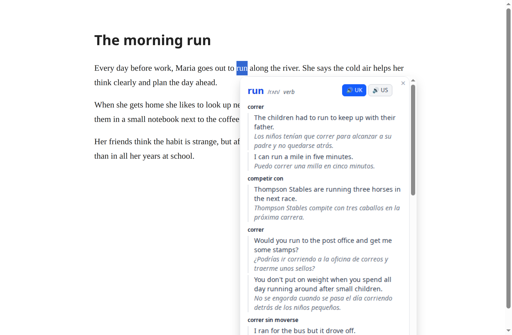
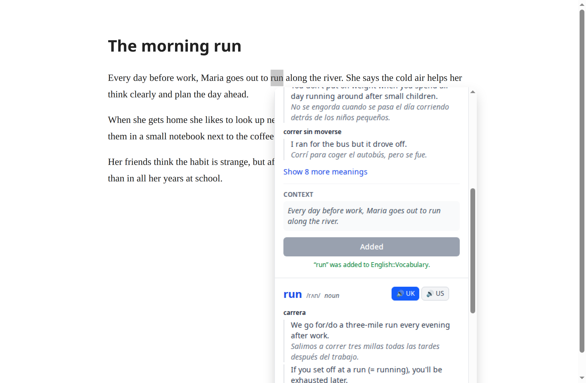
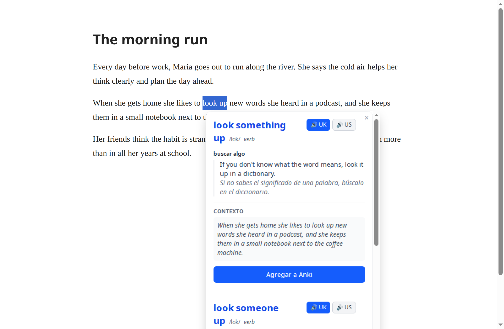
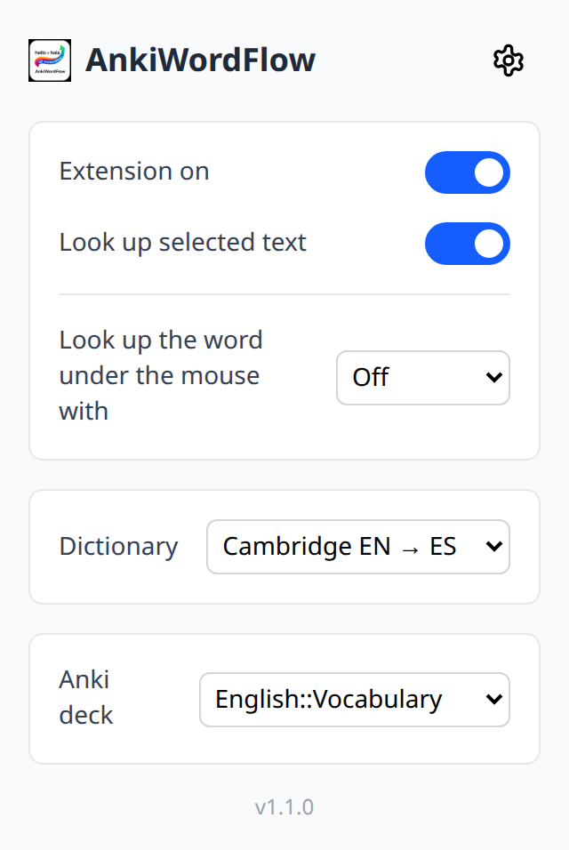
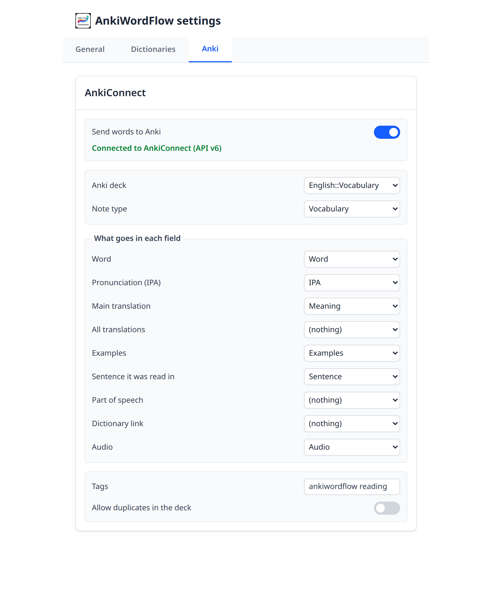
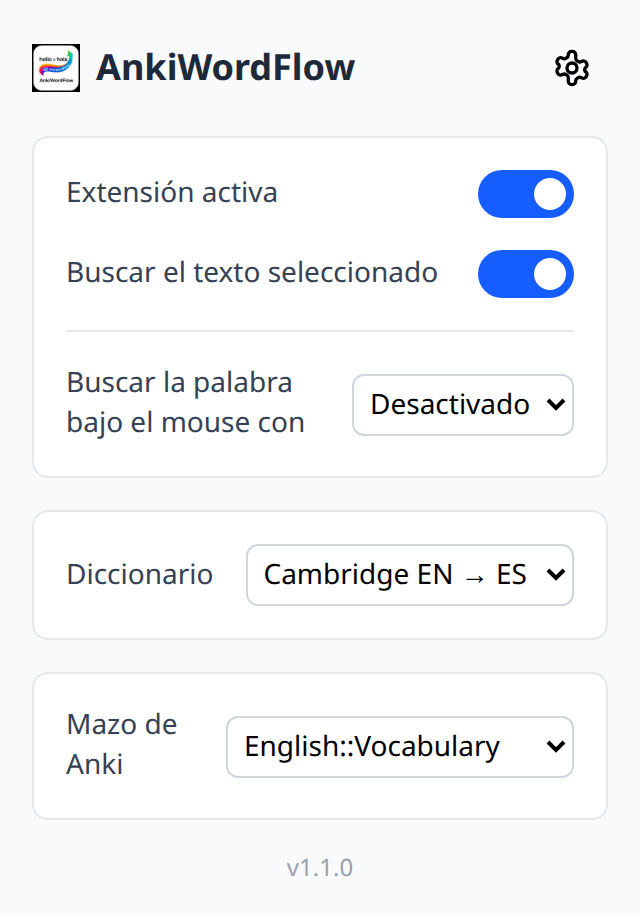

# AnkiWordFlow

A Chrome extension for reading in English. Select a word on any page and it shows the Spanish translation from the
Cambridge English–Spanish dictionary, with pronunciation, audio and examples. One click turns it into an Anki card that
keeps the sentence you read it in.

[Español más abajo](#en-español)



## How it works

1. Select a word or a short phrase (up to four words) on any page. Phrasal verbs such as *look up* work too.
2. The tooltip shows every part of speech Cambridge has, with the IPA, UK and US audio, translations and examples.
   The first four meanings show at once; the rest are one click away.
3. Pick the audio you want on the card and press **Add to Anki**. The note gets the word, the translation, two
   examples, the audio and the sentence from the page, in the fields you chose.

Escape or a click outside closes the tooltip. Instead of selecting, you can also hold Alt, Shift or Ctrl over a word.

| The card goes to your deck | Phrasal verbs, Spanish interface |
| --- | --- |
|  |  |

## Install

AnkiWordFlow is not on the Chrome Web Store, so it is installed from a release.

1. Download `AnkiWordFlow-v<version>.zip` from the [latest release](https://github.com/El-Vitas/AnkiWordFlow/releases/latest) and unzip it.
2. Open `chrome://extensions`, turn on **Developer mode** and click **Load unpacked**.
3. Choose the unzipped folder.

It works in Chrome, Edge, Brave and other Chromium browsers from version 116.

### Connect Anki

Sending cards needs Anki running with the [AnkiConnect](https://ankiweb.net/shared/info/2055492159) add-on
(code `2055492159`). Its default settings already accept requests from extensions, so there is nothing else to set up.
Without Anki the extension still translates; the button just says that Anki is not answering.

## Settings

The toolbar popup turns the extension on and off and switches the deck. The settings page (gear icon) has the rest.

| Popup | Anki settings |
| --- | --- |
|  |  |

- **Deck and note type.** Read from your Anki collection.
- **What goes in each field.** For each piece of data (word, IPA, main translation, all translations, examples,
  sentence, part of speech, dictionary link, audio) choose a field of the note type, or nothing. Two pieces mapped to
  the same field are joined, not overwritten.
- **Tags** for every new note, and whether duplicates in the deck are allowed. By default AnkiConnect refuses a word
  that is already in the deck, and the tooltip says so.

The interface follows the browser language, English or Spanish.

## Privacy and permissions

The extension asks for three things only: storage for its settings, access to `dictionary.cambridge.org` to look words
up, and to `127.0.0.1:8765` to talk to AnkiConnect. It sends nothing anywhere else and collects no data.

The content script runs on every page, because that is where you select words. It only reads the selection and the
sentence around it. The tooltip is an extension page that gets the word from the background service worker, never from
the page itself, and everything sent to Anki is HTML-escaped. A page cannot put its own content into your cards.

## Development

```bash
npm install
npm run check     # ESLint, TypeScript and the Vitest suite
npm run build     # builds the extension into dist/
npm run package   # builds and zips it into release/
```

Load `dist/` with **Load unpacked** to try changes. The content script is built separately
(`vite.content.config.ts`) because Chrome runs content scripts as classic scripts, which cannot import modules.

The parser tests run against real Cambridge pages trimmed to their entries, in `tests/fixtures/cambridge/`. When
Cambridge changes its markup, refresh them with `node scripts/update-fixtures.mjs` and run the tests.

Pushing a tag such as `v1.1.0` that matches the manifest version builds the zip and publishes the release.

## En español

AnkiWordFlow es una extensión de Chrome para leer en inglés. Seleccionas una palabra en cualquier página y te muestra
la traducción al español del diccionario Cambridge, con pronunciación, audio y ejemplos. Con un clic la agrega a Anki
como tarjeta, junto con la oración donde la leíste.



**Instalación.** Descarga el `.zip` de la [última versión](https://github.com/El-Vitas/AnkiWordFlow/releases/latest)
y descomprímelo. Abre `chrome://extensions` y activa el **Modo de desarrollador**. Luego elige **Cargar extensión sin
empaquetar** y selecciona la carpeta. Para enviar tarjetas, Anki debe estar abierto con el complemento
[AnkiConnect](https://ankiweb.net/shared/info/2055492159) (código `2055492159`).

**Uso.** Selecciona una palabra o una frase corta, elige el audio y pulsa **Agregar a Anki**. En la configuración
eliges el mazo, el tipo de nota y qué dato va en cada campo. La interfaz aparece en español si el navegador está en
español.

## License

[MIT](LICENSE)
